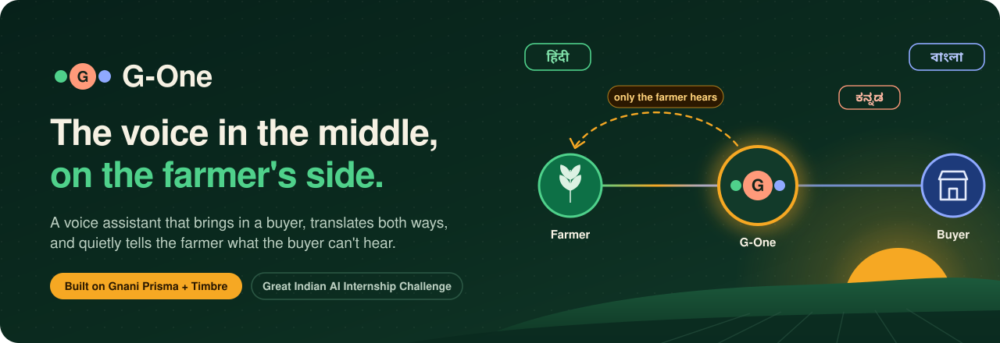
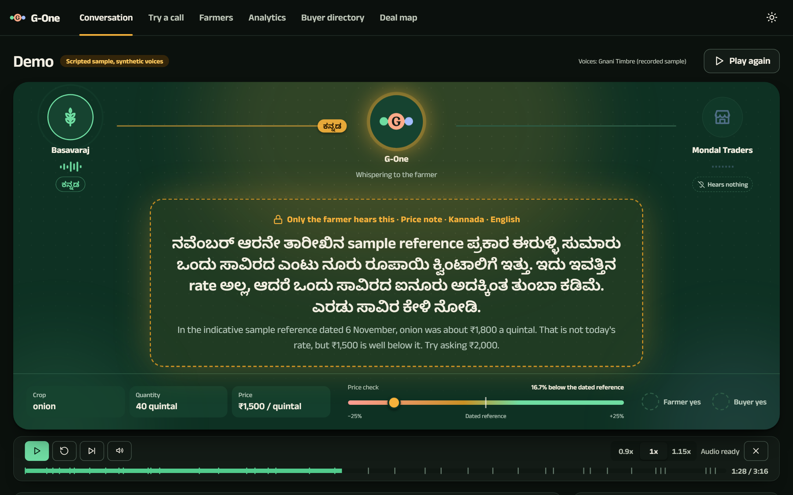
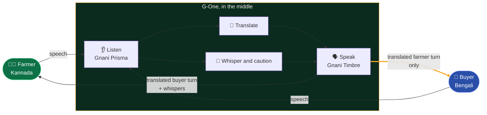
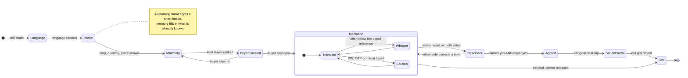
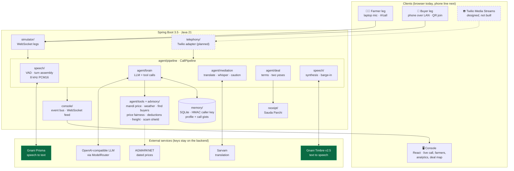
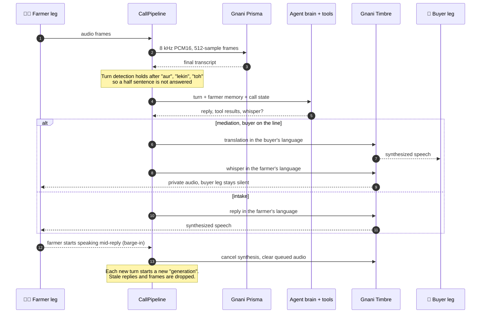
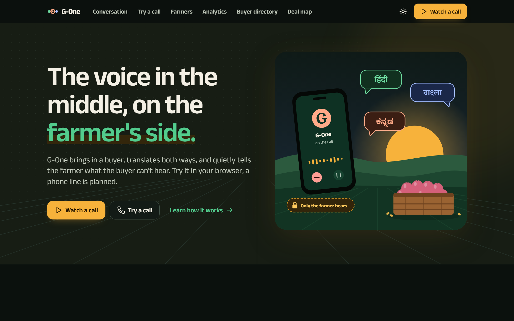
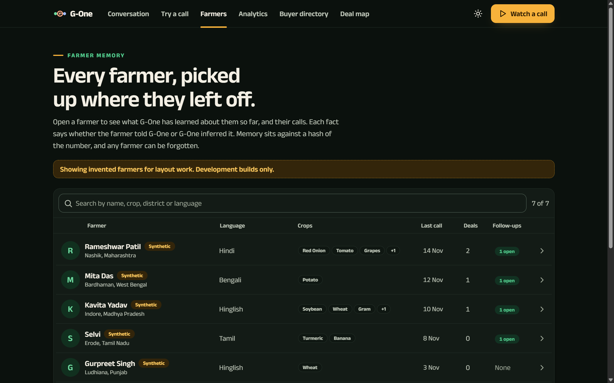
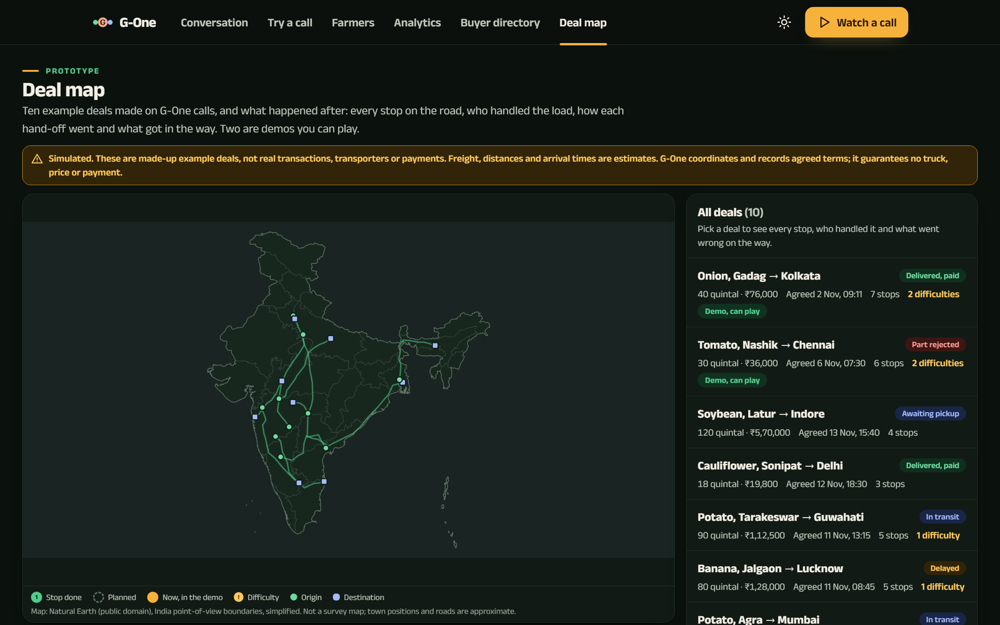

<p align="center"><b>📄 One-pager (PDF):</b> <a href="https://drive.google.com/file/d/1KSldr5w3kdeDQoOESzxSF_vwQtJW9lMN/view?usp=sharing">open on Google Drive</a></p>

<div align="center">



<br>

<a href="docs/Project_Doc.pdf"></a>
<a href="PITCH.md"></a>
<a href="#-a-call-minute-by-minute"></a>
<a href="#-run-it-in-two-minutes"></a>

<br>


<h3>A farmer shouldn't need an app, English, or a middleman who works for the other side.</h3>

<sub>Built by a team of two for the <b>Gnani.ai Great Indian AI Internship Challenge</b> · <a href="PITCH.md">Pitch</a> · <a href="#-how-it-works">How it works</a> · <a href="#-architecture">Architecture</a> · <a href="#-where-gnani-sits">Gnani usage</a> · <a href="#-team">Team</a></sub>

</div>

<br>

## 🌾 In one breath

A farmer talks to G-One by voice, in the language they think in. G-One finds a buyer who wants the crop, asks the
buyer's permission, and brings them onto the same call. From then on G-One sits **in the middle**:

| | |
|---|---|
| 🗣️ **It translates both ways.** | The farmer speaks Kannada, the buyer speaks Bengali. Each hears the other in their own language. |
| 🤫 **It whispers to the farmer.** | Price notes and cautions go to the farmer only. The buyer's line stays silent while G-One advises. |
| 🛡️ **It watches for traps.** | A buyer asking for a UPI PIN or OTP gets a fixed caution to the farmer, and the secret is never repeated. |
| 🤝 **It closes cleanly.** | Terms are read back, both sides say "yes" out loud, and a bilingual **Sauda Parchi** (deal slip) is produced. |
| 🧠 **It remembers.** | A returning farmer is greeted by name with their crops and open follow-ups. Any farmer can say "forget me". |

> [!NOTE]
> **Status, stated plainly.** The full flow runs today as a **browser call**: a laptop is the farmer and a phone on the
> same network joins as the buyer, through the same backend pipeline. The **Twilio phone line is designed** (see
> [ADR 0002](docs/adr/0002-phone-call-middleman.md)) **but not built yet**. All names, numbers and prices in this repo are
> synthetic.

<p align="center">
  
  <br><sub><i>The live call stage during the scripted sample. The buyer's badge says <b>"Hears nothing"</b> while G-One talks to the farmer. The price check compares the offer with a dated reference.</i></sub>
</p>

<br>

## 🔍 The problem

Most Indian farmers sell on small volumes, over the phone, to buyers they can't see, often across a language gap. The
person who "helps" on that call usually works for the other side. Three things go wrong again and again:

1. **The language gap.** A Kannada-speaking onion grower in Gadag and a Bengali trader in Kolkata cannot negotiate
   directly. Someone in the middle translates, and that someone has an interest.
2. **The information gap.** The farmer hears "the market is down" and has no reference point in the moment of the call.
3. **The trust gap.** Payment scams ("type your PIN to receive money", "share the OTP") target exactly these calls.

<table>
<tr>
<td align="center" width="25%"><h2>9.30 cr</h2><sub>rural agricultural households in India<br>(2019 survey estimate)</sub></td>
<td align="center" width="25%"><h2>89.4%</h2><sub>of them owned less than<br>two hectares (2019)</sub></td>
<td align="center" width="25%"><h2>96.8%</h2><sub>of rural people aged 15–29 used<br>a mobile phone (Jan–Mar 2025)</sub></td>
<td align="center" width="25%"><h2>8.2 M+</h2><sub>cybercrime complaints in India,<br>Jan 2020 – Nov 2025 (all kinds)</sub></td>
</tr>
</table>

<sub>Sources, all Government of India releases on PIB: <a href="https://www.pib.gov.in/PressReleasePage.aspx?PRID=2298040&lang=1&reg=3">households</a> ·
<a href="https://www.pib.gov.in/PressReleasePage.aspx?PRID=1910357&lang=2&reg=48">landholding</a> ·
<a href="https://www.pib.gov.in/Pressreleaseshare.aspx?PRID=2132330&lang=2&reg=3">mobile use</a> ·
<a href="https://www.pib.gov.in/PressReleasePage.aspx?PRID=2226082&lang=1&reg=6">cybercrime</a>.
These figures describe the problem. They are not results achieved by G-One.</sub>

The phone is already in the farmer's hand, and voice is the interface they already use. So G-One is not an app.
It is **a voice on the call that works for the farmer**.

<br>

## 📞 A call, minute by minute

This is the scripted sample in the console (`#/demo`), voiced with **Gnani Timbre**. Every name and price is invented.

> **Basavaraj** grows onions in Gadag and speaks **Kannada**. **Mondal Traders** in Kolkata speaks **Bengali**.

| # | What happens | Who hears it |
|:-:|---|---|
| 1 | G-One asks which language to use. Basavaraj answers "ಕನ್ನಡ" and G-One switches to Kannada. | 👨‍🌾 Farmer |
| 2 | *"Are you Basavaraj? … Last time you asked about the onion rate, I remember."* Memory makes the intake short. | 👨‍🌾 Farmer |
| 3 | He has **40 quintal of onion** to sell. G-One finds Mondal Traders in the buyer directory and asks: *"Shall I call them?"* | 👨‍🌾 Farmer |
| 4 | The buyer is asked for their language, told that G-One is an **AI assistant** calling for a farmer, and agrees to talk. | 🏪 Buyer |
| 5 | From here every turn is **translated**, Kannada ⇄ Bengali. | 👨‍🌾 ⇄ 🏪 |
| 6 | Buyer to G-One: *"What is the lowest he will take?"* G-One: *"I do not share either side's limits."* | 🏪 Buyer |
| 7 | Buyer: *"The market is very bad now… ₹1,500 a quintal."* | 👨‍🌾 ⇄ 🏪 |
| 8 | 🤫 **Whisper:** *"In the sample reference dated 6 November, onion was about ₹1,800. That is not today's rate, but ₹1,500 is well below it. Try asking ₹2,000."* | 👨‍🌾 **only** |
| 9 | Farmer asks ₹2,000. Buyer: *"I will give ₹1,900, that is my last word."* | 👨‍🌾 ⇄ 🏪 |
| 10 | Buyer: *"For the advance I am sending a QR code."* 🛡️ **Caution:** *"The buyer is asking you to scan a QR code and enter a UPI PIN. You never need a PIN to receive money."* | 👨‍🌾 **only** |
| 11 | Farmer: *"I will not enter any PIN. Pay when the goods arrive."* | 👨‍🌾 ⇄ 🏪 |
| 12 | G-One reads the terms back to each side in their own language. **Farmer: yes. Buyer: yes.** | 👨‍🌾 + 🏪 |
| 13 | A bilingual **Sauda Parchi** goes to both phones (simulated SMS). G-One then asks both sides whether it may remember the call. | 📄 + 🧠 |

**Outcome of the sample:** ₹1,500 offered → ₹1,900 agreed. That is **₹400 more per quintal, ₹16,000 on 40 quintal**,
and one refused PIN request. *(Scripted figures that show the design, not a measured result.)*

<br>

## 🧭 How it works

### Who hears what

The core idea is that **G-One controls every leg's audio separately**. Nothing is mixed, so G-One decides, turn by turn,
what each person hears.



### The deal flow

Every sale moves through the same guarded states. Nothing skips ahead without a spoken yes.



The console mirrors this as a deal card that moves through **Draft → Read-back → Confirming → Agreed**.

<br>

## 🏗 Architecture



### One turn, end to end



<br>

## 🎙 Where Gnani sits

Gnani's models are the ears and the voice of every call. Both are wired into the live pipeline, behind interfaces in
`core/` so the tests can run against fakes.

<table>
<tr><th width="18%">Model</th><th>What G-One uses it for</th><th width="30%">Where in the code</th></tr>
<tr>
<td><b>Gnani Prisma</b><br><sub>speech to text</sub></td>
<td>Every farmer and buyer turn. Streaming WebSocket on <b>8 kHz PCM16 in 512-sample (64 ms) frames</b>, with an automatic fall back to per-turn uploads (<code>POST /stt/v3</code>) if the stream is unavailable. Telephone-rate audio is exactly what Prisma is trained on.</td>
<td><code>speech/gnani/PrismaSpeechToText.java</code><br><code>speech/PrismClient.java</code><br><code>speech/gnani/GnaniSocket.java</code></td>
</tr>
<tr>
<td><b>Gnani Timbre v2.5</b><br><sub>text to speech</sub></td>
<td>G-One's voice in every language: greetings, translations, whispers, cautions, the read-back. Output is resampled to 8 kHz for the call. Numbers are spelled out as words first, because Timbre reads them more naturally.</td>
<td><code>speech/gnani/TimbreTextToSpeech.java</code><br><code>speech/TimbreClient.java</code><br><code>agent/llm/SpokenNumbers.java</code></td>
</tr>
</table>

The browser never sees a Gnani key; audio goes through the backend. Live speech switches on only when `GNANI_API_KEY`
is set and the offline demo is off ([`LiveSpeechConfig`](backend/src/main/java/com/example/g_one/speech/gnani/LiveSpeechConfig.java)).

<details>
<summary><b>Speech engineering for real conversations</b> (click to expand)</summary>

<br>

| Problem on a voice call | What G-One does |
|---|---|
| A farmer says "haan" while G-One talks | Barge-in needs **700 ms** of speech, so a short acknowledgement doesn't cut G-One off. |
| A sentence pauses on "aur…", "lekin…", "toh…" | Turn detection waits an extra **1.2 s** after a continuation word before answering. |
| G-One's own voice is picked up by the mic | Turns arriving within **3 s** of G-One speaking are checked for being an echo. |
| The farmer interrupts or changes their mind | Every new turn bumps a **generation** counter; replies, audio frames and hang-ups from older generations are dropped. |
| An LLM provider rate-limits mid-call | `ModelRouter` keeps a cooldown and a 60 s token budget per model and moves to the next one; a turn waits at most **1.5 s**. Translation and anything with prices never use a model marked unsafe with numbers. |
| A model "thinks out loud" | Reasoning text is stripped before it can reach speech, the console or the transcript. |

</details>

<br>

## 🛡 Built for the farmer's side

Being the voice in the middle is a position of trust. These rules are in code, and most have tests.

| Principle | How it shows up |
|---|---|
| **The buyer never hears a whisper** | Each leg's audio is separate. Whispers are queued on the farmer's leg only. |
| **Cautions are fixed wording** | A PIN, OTP or threat triggers a pre-written caution (`ScamPatterns`, `ScamShield`). It never repeats the secret. |
| **No "today's price" claims** | Prices are **dated references** ("AGMARKNET listed ₹X for <crop, market> on <date>"), never "fair" or "live". |
| **Two spoken yeses** | A deal exists only after the read-back and a yes from **both** sides. It is a record of the call, not a contract. |
| **The buyer must agree to join** | A matched buyer is asked first and joins only after saying yes. |
| **Memory without the number** | Memory is keyed by an **HMAC of the caller's number**, never the number itself. Caller ID is never called "verified". |
| **It asks before remembering** | At the end of a call G-One asks whether it may keep the main points. Analytics store call content only with consent. |
| **"Forget me" works** | `मुझे भूल जाओ` deletes the farmer's memory and blocks re-seeding. |
| **Nothing said is logged** | Logs carry IDs only. A secret scrubber cleans call gists before they are stored. |
| **Synthetic data only** | Every farmer, buyer and number in the repo, tests and demo is invented (a hackathon rule we follow strictly). |

<br>

## 🖥 The console

<table>
<tr>
<td width="50%"><br><sub><b>Home.</b> The pitch, the problem and a scroll-driven call story.</sub></td>
<td width="50%"><br><sub><b>Conversation.</b> Three parties, live translations, whispers and the deal card.</sub></td>
</tr>
<tr>
<td width="50%"><br><sub><b>Farmers.</b> What G-One learned about each farmer, with whether they said it or G-One inferred it.</sub></td>
<td width="50%"><br><sub><b>Deal map</b> <i>(prototype, simulated)</i>. Where agreed deals go next: every stop, hand-off and difficulty.</sub></td>
</tr>
</table>

<br>

## ⚡ Run it in two minutes

The offline demo runs a whole call with a scripted model and speech path. **No API keys, no network, no phone.**

**Prerequisites:** JDK 21 and [Bun](https://bun.sh).

```powershell
# Terminal 1: backend in offline demo mode (Windows PowerShell)
cd backend
$env:G_ONE_DEMO_MODE = "true"
.\mvnw.cmd spring-boot:run
```

```sh
# Terminal 1: backend in offline demo mode (macOS / Linux / Git Bash)
cd backend && G_ONE_DEMO_MODE=true ./mvnw spring-boot:run
```

```sh
# Terminal 2: web console
cd web && bun install && bun run dev      # open http://localhost:5173
```

Then open **`#/demo`** for the voiced sample call or **`#/call`** to try a call yourself.

For live Gnani speech, set the variables listed in [`.env.example`](.env.example) (`GNANI_API_KEY`, an
OpenAI-compatible LLM endpoint, and a memory HMAC key). The farmer-memory take and the phone-as-buyer setup are in
**[docs/RUNBOOK.md](docs/RUNBOOK.md)**.

<details>
<summary><b>Checks</b></summary>

```sh
bun run typecheck && bun run lint      # web, from the repo root
cd backend && ./mvnw -q test           # backend
```

Tests never call Gnani, a phone line or a language model. They run against fake upstream servers.

</details>

<br>

## 🧱 Tech stack

| Layer | Choice | Why |
|---|---|---|
| Speech | **Gnani Prisma** + **Gnani Timbre v2.5** | Trained on telephonic Indian audio, Indic voices, 8 kHz friendly. |
| Backend | Java 21, Spring Boot 3.5, WebSockets | Long-lived audio sockets and strict concurrency control per call leg. |
| Brain | Any OpenAI-compatible `/chat/completions` with tool calling | Provider-agnostic; a `ModelRouter` fails over between models. |
| Translation | Sarvam translate, with an LLM fall back | Indic-first translation for code-mixed speech. |
| Memory | SQLite behind a `MemoryStore` interface | One file per demo take, easy to reset, no server to run. |
| Console | React 19, Vite, TypeScript, Tailwind 4 | Fast to iterate; native-script fonts for Devanagari, Bengali and Kannada. |
| Market data | AGMARKNET (public) or a bundled dated snapshot | Prices with a date and a market, never "live". |

<details>
<summary><b>Repository map</b></summary>

```text
backend/src/main/java/com/example/g_one/
├── core/          contracts: legs, turns, speech, memory, console events
├── agent/
│   ├── pipeline/  CallPipeline: listen → think → speak, barge-in, hang-up
│   ├── brain/     LLM brain, welcome back, language replies
│   ├── mediation/ translation, whispers, scam patterns, price basis
│   ├── deal/      offers, terms, yes/no reading, agreement
│   ├── tools/     mandi price, weather, buyers, memory tools
│   └── demo/      scripted offline model and speech
├── advisory/      price fairness, deductions, freight, quality terms, scam shield
├── speech/        Gnani Prisma and Timbre clients, VAD, resampling, mulaw
├── memory/        SQLite store, call gists, seeding, secret scrubber
├── receipt/       Sauda Parchi renderer
├── analytics/     call records, consent-gated content
├── console/       WebSocket feed and REST for the console
└── simulator/     browser call legs (farmer laptop, buyer phone)

web/src/           console: landing, demo, call, farmers, analytics, buyers, deal map
docs/adr/          architecture decisions with reasons
```

</details>

<br>

## 🧪 Engineering quality

- **862 backend tests and 111 web tests** (last full count, 10 Nov 2026). None calls Gnani, a phone or an LLM: they use
  fake upstream servers built on the JDK `HttpServer`.
- **Decisions are written down** as ADRs: [stack and layout](docs/adr/0001-stack-and-layout.md),
  [the phone-call middleman](docs/adr/0002-phone-call-middleman.md),
  [how two people and their agents work in parallel](docs/adr/0003-parallel-agent-workflow.md).
- **Domain language is fixed** in [CONTEXT.md](CONTEXT.md): *farmer, buyer, leg, turn, whisper, caution, deal summary*
  mean one thing each, in code, UI and docs.
- **Every PR gets an independent review** from a different model family before merge, with CI green.

<br>

## 🗺 Status and what's next

| Area | State |
|---|---|
| Two-party call with translation, whispers and cautions | ✅ Working in the browser call |
| Buyer matching and buyer consent | ✅ Working |
| Read-back, two yeses, Sauda Parchi | ✅ Working |
| Farmer memory, welcome back, forget me | ✅ Working |
| Console: conversation, farmers, analytics, buyers | ✅ Working |
| Deal map | 🧪 Prototype on simulated deals |
| Languages | ✅ Hindi, English, Hinglish exercised in live tests · 🧪 Bengali, Tamil, Kannada configured, awaiting native-speaker review |
| Twilio phone line (two independent legs, each its own media stream) | 📐 Designed in ADR 0002, next to build |
| Latency | ⏳ Not yet measured; we will publish measured seconds, not adjectives |

<br>

## 🏆 Why it fits the challenge

| Award | Fit |
|---|---|
| **Real Deal** (useful real-world problem) | Built around farmers selling produce, with price references, scam cautions and a deal record. |
| **Mixed Vibes** (code-mixed voice) | Hinglish is a first-class language; turn detection understands "aur / lekin / toh" pauses. |
| **Two-Person Army** (team of two) | Two lanes, one shared contract layer, written decisions, reviewed PRs. |

<br>

## 👥 Team

| | Member | Lane | Contributions |
|---|---|---|---|
| 🧠 | **Nikhil Sah** · [@Sah-Nikhil](https://github.com/Sah-Nikhil) | Brain and memory | Core contracts, agent brain and tools, farmer memory (profile, call gists, HMAC caller key, forget me, seeding), memory demo, product decisions (ADR 0002). |
| 🖥️ | **Nishant** · [@Nishannt-X](https://github.com/Nishannt-X) | Console, speech and launch | Repository owner. Call pipeline and Gnani speech integration, mediation, the web console (call stage, farmers, analytics, deal map), browser call simulator, demo and launch. |

<sub>G-One started from our earlier project, <a href="https://github.com/Nishannt-X/G_One-AI">G_One-AI</a>, and reuses its verified Gnani integration.</sub>

<br>

<div align="center">

**G-One** · the voice in the middle, on the farmer's side.

<sub>Speech by <b>Gnani Prisma</b> and <b>Gnani Timbre</b> · Translation by Sarvam · Built for the Gnani.ai Great Indian AI Internship Challenge<br>
All people, numbers and prices shown are synthetic. A deal in G-One is a record of a call, not a contract.</sub>

</div>
